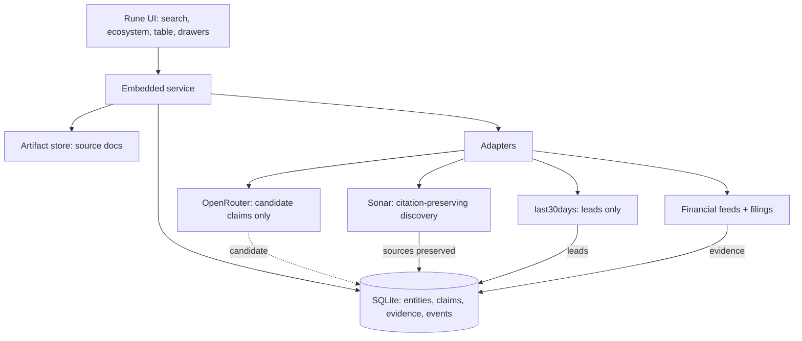

# VEIN — Global-Market Intelligence - Plan

## Goal Capsule

- **Objective:** A user can search a real economic question, see a bounded ecosystem map, and click any company, facility, relationship, or financial figure down to dated primary evidence — with gaps rendered as honest missing states, not generated numbers.
- **Means:** One Rust binary per product shape — embedded local service over SQLite records and a filesystem artifact store, with a Rune (`anomalyco/rune`) UI (KTD1, KTD2).
- **Authority:** `docs/BRIEF.md` governs product scope and the epistemic/freshness rules; this plan governs implementation; `AGENTS.md` and `duketopceo/luke-agents` govern standards.
- **Stop conditions:** every displayed factual edge and financial cell resolves to provenance + date context + visible missing-data state, verified on two contrasting ecosystems.
- **Execution profile:** `ce-work` consumes Implementation Units in order; spikes (U5–U7 adapter verification) may reorder within Phase 1.
- **Who finishes:** implementing agent builds units; owner validates the two-ecosystem release gate.

---

## Product Contract

### Summary

vein answers "how does this part of the global economy connect — and prove it" through a single search box that produces a bounded, explorable ecosystem graph. Every node (entity), edge (typed relationship with an epistemic label), and financial cell carries provenance and separate freshness timestamps. Model calls produce candidate claims only; evidence comes from primary sources, structured feeds, and citation-preserving discovery.

### Problem Frame

Existing market-intelligence tools either show undifferentiated graph spaghetti or generated summaries with no audit trail. Analysts cannot tell a documented supply contract from a model's guess, and "researched today" is routinely conflated with "true today." vein's differentiation is inspectability: the connection between two things is the most important click in the product.

### Key Decisions

- **Epistemic labels, not confidence scores.** Relationships render as documented / historical / industry exposure / candidate / disputed; a calibrated score is deferred until a defensible method exists. Governs R8, R9.
- **Five separate timestamps.** Published, occurred, period-covered, retrieved/checked, effective/ceased never collapse into one "freshness." Governs R14–R16.
- **Model output is never evidence.** OpenRouter calls produce candidate claims that require independent evidence to promote. Governs R20–R22.
- **Two contrasting validation ecosystems.** Quartz→semiconductor plus agricultural inputs or electricity infrastructure prove generality. Governs R27.
- **Local-first, honest gaps.** SQLite + filesystem artifacts; unavailable/delayed/not-licensed are first-class states. Governs R17–R19.

### Requirements

**Search and ecosystem**

- R1. One search box accepts a company, commodity, facility, industry, country, or economic event and returns a bounded ecosystem — a small comprehensible subgraph, not a global hairball.
- R2. The ecosystem groups nodes into stages: extraction, processing, energy, equipment, logistics, customers.
- R3. Users expand branches deliberately; the initial view stays small enough to read.

**Entity and identity**

- R4. The identifier model is global from day one: legal entity, security, listing, exchange, share class, currency, and fiscal calendar are separate concepts.
- R5. A company with multiple listings resolves to one legal entity, never duplicate suppliers.
- R6. Entity pages show ownership, geography, activities, and all identifiers with their provenance.

**Relationships and evidence**

- R7. Relationships are typed: ownership/operation, documented contracts, physical flows, utility service/PPA, industry exposure, analyst hypotheses.
- R8. Every edge carries exactly one epistemic label (documented, historical, industry exposure, candidate, disputed) and never renders unlabeled.
- R9. Clicking an edge answers: how do we know, when was it true, and does the source establish that exact relationship — including conflicting sources.
- R10. Evidence records are append-only; newer research proposes changes to established facts and never silently overwrites them.

**Financials**

- R11. Financial drill-down covers revenue, margins, cash flow, debt, capex, and segments.
- R12. Every financial cell carries reporting period, currency, original disclosure, and calculation lineage.
- R13. Financial scope is labeled: consolidated company, reported segment, or facility-specific disclosure.

**Freshness and change**

- R14. Five timestamps are stored per fact: source published, event occurred, period covered, retrieved/checked, effective/ceased.
- R15. Refresh policies differ per object type (quotes, earnings, ownership, contracts, community discussion).
- R16. "What changed since my last visit" shows additions, removals, disputed relationships, and revised financials separately.

**Coverage and gaps**

- R17. A coverage matrix shows what financial/relationship data exists per market and per object type.
- R18. Missing data renders as unavailable, delayed, or not licensed — never filled with generated numbers.
- R19. Launch claims global search with explicit coverage, not equal completeness everywhere.

**Sources and adapters**

- R20. OpenRouter is used for extraction, classification, synthesis, and verification — its output lands as candidate claims only.
- R21. Sonar provides web-grounded discovery with underlying sources preserved; important claims are independently verified.
- R22. `last30days` output is wrapped in an adapter and treated as discovery leads, never audited fact.
- R23. Primary-source ingestion (filings, exchange notices, announcements, regulatory documents) grounds material facts in the original record.
- R24. Structured financial feeds display coverage, reporting periods, delays, and redistribution limits.

**Interface**

- R25. Floorplan-style interaction: overview, zoom, select, inspect — plus a synchronized table so the graph is never the only retrieval path.
- R26. The UI is built with Rune + rune-kit; every interactive element does what it says.

**Validation**

- R27. The release gate passes on two contrasting ecosystems (quartz/semiconductor + one of agricultural inputs or electricity infrastructure).
- R28. Every displayed factual edge and financial cell has provenance, date context, and a visible missing-data state.

### Actors

- **A1 — Researcher (primary user):** searches, explores the ecosystem, drills into evidence, checks what changed.
- **A2 — Model providers (OpenRouter, Sonar):** called through adapters; outputs are untrusted input to the claim pipeline.
- **A3 — Data sources (feeds, filings, community tools):** produce evidence and leads through adapters.

### Key Flows

- F1. Search → bounded ecosystem → expand stage → entity → relationship → evidence drawer → source document.
- F2. Edge click → evidence panel shows source passage, dates, qualifications, conflicting sources.
- F3. Return visit → "what changed" diff of additions/removals/disputes/revisions since last visit.

### Acceptance Examples

- AE1. Given the query "quartz-to-semiconductor chain," when results render, then the initial ecosystem fits on one screen, every edge has an epistemic label, and at least the extraction→processing→customer spine is navigable.
- AE2. Given a company with dual listings, when it appears in an ecosystem, then it is one node with two listing identifiers — not two suppliers.
- AE3. Given a financial figure with no licensed feed coverage, when the cell renders, then it shows `not licensed` or `unavailable` — never an estimate.
- AE4. Given a Sonar-sourced claim about a supply contract, when it appears as `candidate`, then promoting it to `documented` requires a primary-source evidence record.

### Scope Boundaries

**Deferred for later:** server-side data service (until licensing/scheduled refresh demands it), globe-scale visualization, calibrated confidence scores, ecosystems beyond the two validation cases, real-time market data.

**Outside this product's identity:** a mining-only tool, a generic "related to" graph, AI-generated financial numbers, social/trading features.

### Sources

- `docs/BRIEF.md` — product brief (requirements origin)
- `https://github.com/anomalyco/rune` — UI framework (`dev@24bd7bbb`)
- `https://github.com/mvanhorn/last30days-skill` — community-research adapter source
- Floorplan reference repo — **unverified**; U8 treats interaction details as a spike, not a dependency

---

## Planning Contract

### Key Technical Decisions

- KTD1. **Single Rust binary, embedded service + Rune UI.** The service and UI share one process and one SQLite handle; no separate server for v1. (session-settled: user-directed — Rune everywhere chosen over a web stack.)
- KTD2. **SQLite + filesystem artifact store, local-first.** Records in SQLite under XDG data dir; source documents and large payloads as content-addressed files. Matches the brief's recommended starting implementation.
- KTD3. **Claims reference evidence; evidence is append-only.** Every displayed fact resolves to evidence IDs. Corrections are new evidence records that supersede — never updates that erase.
- KTD4. **Epistemic label is a required enum on every edge.** `documented | historical | industry_exposure | candidate | disputed`, stored with the relationship, enforced at the schema level.
- KTD5. **Adapters behind traits; model output quarantined.** `EvidenceSource` trait for feeds/filings; `DiscoveryAdapter` trait for Sonar/last30days; `ModelClient` for OpenRouter. Model responses can only create `candidate` claims.
- KTD6. **Verification spikes precede adapter commitment.** OpenRouter response fields, Sonar citation preservation (direct vs OpenRouter route), last30days output shape, and financial-feed licensing are verified in U5–U7 before downstream units depend on them.
- KTD7. **Identifier model normalized before content.** Legal entity / security / listing / exchange / share class / currency / fiscal calendar are separate tables from day one — retrofitting identity is the expensive path.

### High-Level Technical Design

Data flow rule: only `EvidenceSource` adapters write evidence records. `DiscoveryAdapter` and `ModelClient` outputs land as `candidate` claims or leads that must be promoted by evidence before display as fact.

### Assumptions

- Rust 1.99.1 toolchain (installed; matches rune's `rust-toolchain.toml`).
- rune-kit components cover the needed primitives; gaps go upstream or into a thin local wrapper — no fork.
- SEC EDGAR and/or equivalent free primary sources cover the first US-listed names in the quartz chain; global coverage is honestly partial at launch.
- Financial feed licensing is unresolved — the plan ships the interface and coverage matrix first, licenses later.

### Sequencing

Phase 0 (U1–U3): workspace, schema, evidence model — everything else depends on it.
Phase 1 (U4–U7): search + adapters with verification spikes interleaved.
Phase 2 (U8–U10): Rune views + change layer.
Phase 3 (U11): second ecosystem + release gate.

---

## Implementation Units

| Unit | Title | Files (primary) | Depends on |
|---|---|---|---|
| U1 | Workspace + service skeleton + Rune shell | `Cargo.toml`, `crates/vein/src/` | — |
| U2 | Identifier schema + migrations | `crates/vein-db/` | U1 |
| U3 | Evidence, claim, relationship schema | `crates/vein-db/` | U2 |
| U4 | Entity search + bounded ecosystem assembly | `crates/vein-core/` | U3 |
| U5 | OpenRouter adapter (candidate-claim gate) | `crates/vein-adapters/` | U3 |
| U6 | Sonar + last30days adapters (verification spikes) | `crates/vein-adapters/` | U3 |
| U7 | Financial feed interface + coverage matrix | `crates/vein-adapters/`, `crates/vein-core/` | U4 |
| U8 | Ecosystem view + synchronized table (Rune) | `crates/vein-ui/` | U4 |
| U9 | Evidence drawer + entity/relationship inspectors | `crates/vein-ui/` | U8 |
| U10 | Recent-changes layer + "what changed" | `crates/vein-core/`, `crates/vein-ui/` | U9 |
| U11 | Second ecosystem validation + release gate | `crates/vein-core/`, `docs/` | U10 |

### U1. Workspace + service skeleton + Rune shell

- **Goal:** `cargo build` produces a running `vein` binary that opens a Rune window with a working search box and honest empty states.
- **Requirements:** R1, R26, R28 (empty states count as missing-data states).
- **Files:** `Cargo.toml` (workspace members), `crates/vein-db/`, `crates/vein-core/`, `crates/vein-adapters/`, `crates/vein-ui/`, `rust-toolchain.toml`.
- **Approach:** Cargo workspace with four crates: `vein-db` (rusqlite wrapper, migrations), `vein-core` (service logic, no UI deps), `vein-adapters` (external calls), `vein-ui` (Rune app embedding the service in-process). Rune pinned at `24bd7bbb`; start from rune's `examples/hello` pattern. SQLite at `$XDG_DATA_HOME/vein/vein.db`; artifacts at `…/artifacts/`.
- **Test scenarios:** `cargo build --workspace` clean; `cargo test -p vein-db` migration round-trip; headless rune render dumps element tree containing the search field.
- **Verification:** `cargo build --workspace && cargo test --workspace && cargo clippy --workspace -- -D warnings`.

### U2. Identifier schema + migrations

- **Goal:** global identifier model exists as normalized tables before any content loads.
- **Requirements:** R4, R5.
- **Files:** `crates/vein-db/src/schema/` (migrations `0001_identifiers.sql` …).
- **Approach:** tables for `legal_entity`, `security`, `listing`, `exchange`, `share_class`, `currency`, `fiscal_calendar`, plus `entity_identifier` join (scheme + value + issuer + valid-period). All timestamps `TIMESTAMPTZ`-equivalent (RFC3339 text or integer epoch — pick one, document).
- **Test scenarios:** migration up/down clean on fresh DB; a dual-listed company is one `legal_entity` with two `listing` rows.
- **Verification:** `cargo test -p vein-db`.

### U3. Evidence, claim, relationship schema

- **Goal:** the epistemic core — evidence records, claims, typed relationships, five timestamps — is enforced by schema.
- **Requirements:** R7–R10, R14, KTD3–KTD5.
- **Files:** `crates/vein-db/src/schema/` (`0002_evidence.sql` …), `crates/vein-db/src/types.rs`.
- **Approach:** `evidence` (append-only: source kind, URI, content hash, artifact path, published/occurred/period/retrieved/effective timestamps, raw payload ref); `claim` (subject, predicate, object, epistemic label enum, evidence_ids JSON, status candidate/documented/disputed/superseded); `relationship` view/table joining claims into edges. `candidate` is the only label model output may write.
- **Test scenarios:** attempt to insert edge without epistemic label fails; superseding a claim preserves the original row; five timestamp fields independently settable.
- **Verification:** `cargo test -p vein-db`.

### U4. Entity search + bounded ecosystem assembly

- **Goal:** a query resolves to entities and assembles a bounded subgraph grouped by stage.
- **Requirements:** R1–R3, R6.
- **Files:** `crates/vein-core/src/search.rs`, `crates/vein-core/src/ecosystem.rs`.
- **Approach:** deterministic entity resolution first (identifier exact match → name/alias with disambiguation list); ecosystem = BFS from seed entity capped by stage quotas and edge-label filters (documented+historical expand; candidate collapsed by default). No model call in the assembly path.
- **Test scenarios:** fixture graph → query returns ≤N nodes grouped by stage; dual-listed entity appears once; candidate-only branches hidden until expanded.
- **Verification:** `cargo test -p vein-core` with fixture DB.

### U5. OpenRouter adapter — candidate-claim gate

- **Goal:** model extraction/classification runs behind a hard gate: output can only create `candidate` claims.
- **Requirements:** R20, KTD5, KTD6.
- **Files:** `crates/vein-adapters/src/openrouter.rs`, `crates/vein-adapters/src/gate.rs`.
- **Approach:** typed `ModelClient` trait; OpenRouter chat-completions client with structured-output prompt → parsed claims validated against schema → written only as `candidate`. Spike first: confirm response fields needed (choices, usage, model reported) against live API using `OPENROUTER_API_KEY`; record findings in `docs/research/`.
- **Test scenarios:** mocked client returning malformed JSON → rejected, no DB write; valid output → candidate claims only, never documented; usage/cost logged to event stream.
- **Verification:** `cargo test -p vein-adapters`; spike note committed.

### U6. Sonar + last30days adapters — verification spikes

- **Goal:** citation-preserving discovery (Sonar) and community leads (last30days) land as sources/leads, never facts.
- **Requirements:** R21, R22, KTD5, KTD6.
- **Files:** `crates/vein-adapters/src/sonar.rs`, `crates/vein-adapters/src/last30days.rs`, `docs/research/`.
- **Approach:** **Spike A:** call Sonar direct API; verify response preserves citations/source URLs. **Spike B:** same query via OpenRouter `perplexity/sonar` — compare field preservation; choose direct unless equivalent. **Spike C:** run `last30days` once against a real topic; wrap its structured output behind `DiscoveryAdapter` emitting leads only. Record all three in `docs/research/`.
- **Test scenarios:** sonar response → evidence records carry source URLs verbatim; last30days output → `candidate`/lead rows tagged community-source; adapter failure → graceful empty, no fabricated results.
- **Verification:** `cargo test -p vein-adapters`; spike notes committed with raw (sanitized) samples.

### U7. Financial feed interface + coverage matrix

- **Goal:** financial data has a typed interface, scope labels, and an honest coverage matrix — before any licensed feed is chosen.
- **Requirements:** R11–R13, R17, R24, R18.
- **Files:** `crates/vein-adapters/src/feeds/mod.rs`, `crates/vein-core/src/coverage.rs`, `crates/vein-db/src/schema/0003_financials.sql`.
- **Approach:** `FinancialFeed` trait (statements, quotes, corporate actions, identifiers) returning typed records with period/currency/scope (`consolidated | segment | facility_specific`). Seed one free primary source (SEC EDGAR companyfacts for US-listed names) as the reference adapter. Coverage matrix table: object type × market → available/delayed/not_licensed/unsupported.
- **Test scenarios:** EDGAR fixture → financial cell renders period+currency+scope; uncovered market → `not licensed` cell; segment vs consolidated never conflated.
- **Verification:** `cargo test -p vein-core -p vein-adapters`.

### U8. Ecosystem view + synchronized table (Rune)

- **Goal:** Floorplan-style overview/zoom/select/inspect over the bounded ecosystem, with a synchronized table.
- **Requirements:** R2, R3, R25, R26.
- **Files:** `crates/vein-ui/src/ecosystem.rs`, `crates/vein-ui/src/table.rs`.
- **Approach:** stage-clustered node layout (deterministic, not force-directed noise); zoom = stage drill-down; selection syncs graph ↔ table bidirectionally; epistemic label is a colored badge + text label (never color-only). Check rune-kit for existing graph/canvas primitives first; Floorplan repo is unverified — treat as interaction reference only. Verify headlessly via rune's PNG/element-tree dump.
- **Test scenarios:** headless render of fixture ecosystem → element tree contains stage groups, labeled edges, table rows matching node count; select node → table scrolls/highlights.
- **Verification:** `cargo build -p vein-ui`; headless render snapshot checked into `docs/screens/`.

### U9. Evidence drawer + entity/relationship inspectors

- **Goal:** clicking any edge/entity/financial cell opens evidence: source passage, dates, qualifications, conflicts.
- **Requirements:** R6, R9, R12, R13, R25.
- **Files:** `crates/vein-ui/src/evidence.rs`, `crates/vein-ui/src/entity.rs`.
- **Approach:** evidence drawer shows artifact excerpt (fetched from artifact store), all five timestamps, epistemic label history, and conflicting claims when `disputed`. Financial cells link to disclosure + calculation lineage.
- **Test scenarios:** edge click → drawer lists ≥1 evidence record with source URI and dates; disputed edge → both claims visible; missing artifact → `unavailable` state, not blank.
- **Verification:** `cargo test -p vein-ui` (state-level) + headless render check.

### U10. Recent-changes layer + "what changed since my last visit"

- **Goal:** dated changes propose diffs against established facts; nothing silently overwrites.
- **Requirements:** R10, R14, R15, R16.
- **Files:** `crates/vein-core/src/changes.rs`, `crates/vein-ui/src/changes.rs`.
- **Approach:** per-object-type refresh policies (config table, not one TTL); change feed = new evidence/claims since `last_visit` watermark; UI groups additions / removals / disputes / revisions.
- **Test scenarios:** two refresh cycles → second visit shows only deltas; a disputed update appears under disputes, not as silent replacement; per-type TTLs differ (quote vs contract).
- **Verification:** `cargo test -p vein-core`.

### U11. Second ecosystem validation + release gate

- **Goal:** prove generality on a contrasting domain and run the full release gate.
- **Requirements:** R27, R28.
- **Files:** `docs/validation/second-ecosystem.md`, fixture data under `crates/vein-core/tests/fixtures/`.
- **Approach:** pick agricultural inputs OR electricity infrastructure (decide at start of unit; electricity exercises utility/PPA relationships the quartz chain may not). Run the full slice: search → ecosystem → table → evidence → changes. Audit every rendered edge/cell against R28.
- **Test scenarios:** scripted audit — every edge in rendered output maps to a claim row with evidence_ids non-empty or explicit missing state; every financial cell has period+currency+scope or honesty state.
- **Verification:** audit script output committed; `cargo test --workspace` green.

---

## Verification Contract

| Gate | Command / check | Applies to |
|---|---|---|
| Build | `cargo build --workspace` | all units |
| Test | `cargo test --workspace` | all units |
| Lint | `cargo clippy --workspace -- -D warnings` + `cargo fmt --check` | all units |
| Schema | `cargo test -p vein-db` migration up/down | U2, U3, U7 |
| Adapter spikes | committed notes in `docs/research/` with sanitized samples | U5, U6 |
| UI render | headless rune PNG + element-tree dump per view | U8–U10 |
| Release gate | two-ecosystem audit per R27/R28 | U11 |

No CI exists yet (GitHub Actions minutes policy); verification is local and reproducible from this table.

## Definition of Done

- All units merged; `cargo build/test/clippy` clean on `main`.
- Release gate (U11) passes on both ecosystems: every edge and financial cell has provenance, date context, and a visible missing-data state.
- Spike findings committed under `docs/research/`; adapter choices recorded as KTD amendments if they diverge from this plan.
- No abandoned-attempt code left in the diff; candidate-only quarantine enforced in `vein-adapters`.
- `ROADMAP.md` checkboxes updated to match shipped state.
